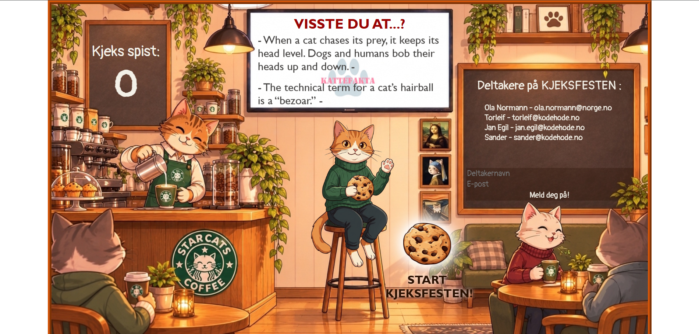

# StarCats Coffee

Et lite React-prosjekt (React Oppgave 2) der tre øvelser henger sammen i en kattekafé.

**Se siden her:** https://siannon91.github.io/starcats-coffee/

## Hva er med

- **Kjeksklikker:** Trykk på kjeksen for å få ett poeng per klikk. Poengene vises på tavlen til venstre, og katten bytter bilde for hvert klikk.
- **Kattefakta:** Henter fem kattefakta fra et API og viser dem på TV-skjermen. Siden viser «Loading...» mens dataene hentes, og en feilmelding hvis noe går galt.
- **Deltakere:** En liste over deltakere på tavlen til høyre. Man kan melde seg på med navn og e-post, og e-posten blir kontrollert før den legges til.

## Teknologi og kilder

- React og Vite
- `useState` og `useEffect`
- Kattefakta fra [catfact.ninja](https://catfact.ninja)
- Skrifttypen Pangolin fra Google Fonts
- Publisert med GitHub Pages